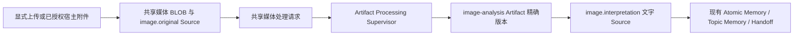

# 图片证据与共享媒体实现

图片能力默认关闭，实现对齐 [RFC #1972](https://github.com/oceanbase/powercontext/pull/1972)，关联 [#1932](https://github.com/oceanbase/powercontext/issues/1932) 与 [PR #1956](https://github.com/oceanbase/powercontext/pull/1956)。PNG/JPEG 首期支持耐久文件 SQLite；其他数据库的文字业务照常运行，图片写入在保存字节或 Source 前明确拒绝。

原图、机器解释、Memory 和新会话召回分别验收。解释成功不保证生成 Memory；重试与重新解析不改写历史证据。视觉模型可以独立工作，无需配置普通生成模型。

## 实现入口

- [数据、操作与权限契约](contracts.md)：五个公共操作、共享三表与逐陈述排序。
- [存储启用、迁移和备份](phase2-usage.md)：可选解码依赖、已有数据库的显式迁移与兼容策略。
- [解释、重试与 Memory](phase34-usage.md)：既有 Supervisor、请求预算与迟到证据。
- [宿主采集与查看](phase56-usage.md)：标准 setup、持久授权和精确历史回读。
- [架构接入](contract-integration-analysis.md)、[验证范围](integration-review.md) 与 [容量测量](media-capacity-results.json)。

## 开发和验收规则

在隔离 worktree、临时数据库和独立端口中开发，不操作既有服务或私有模型配置。每次实现前在 [实施记录](implementation-log.md) 写明目标，结束时记录实际改动、执行证据和限制。公共 HTTP 合同以 `openapi/powercontext.yaml` 为准，运行官方 Python、JavaScript 与 Desktop 生成器，不手改生成文件。

源代码入口为 `builtin/media`、`builtin/images`、`builtin/artifacts/image_analysis.py` 和 `builtin/artifacts/atomic_memory/ordering.py`。域规则由运行时拥有，HTTP、CLI、宿主与 Dashboard 负责翻译和展示。使用仓库 `AGENTS.md`、`REVIEW.md` 及相关 RFC 审查。

真实宿主、外部视觉模型、普通 Memory 模型和全新会话召回分别记录。受控 loopback provider 和实际子进程测试证明本地协议、调度与恢复行为，不证明外部模型质量、Desktop UI、新会话注入或其他平台资格。较早的 [可行性材料](feasibility.md)、[宿主附件证据](codex-capture-evidence.md) 和 [桌面测试指南](desktop-testing.md) 是对应版本的历史探测材料；其中实验接口和文件资产流程不适用于共享媒体部署。
